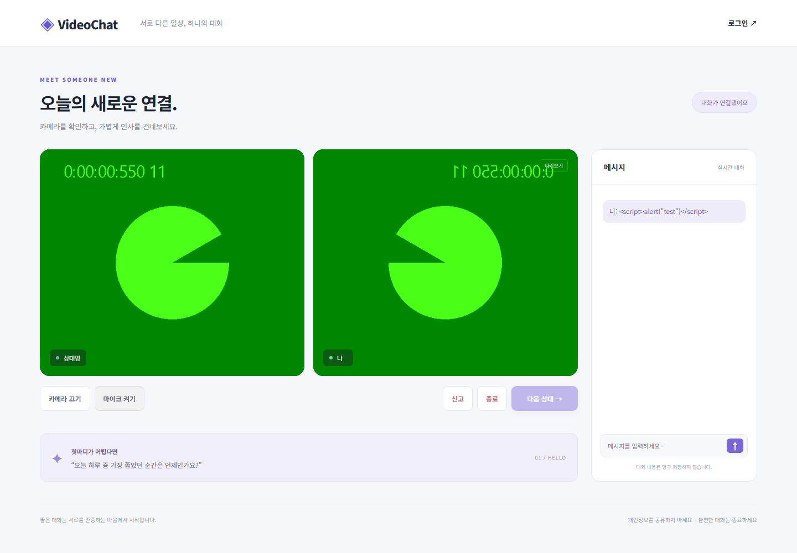
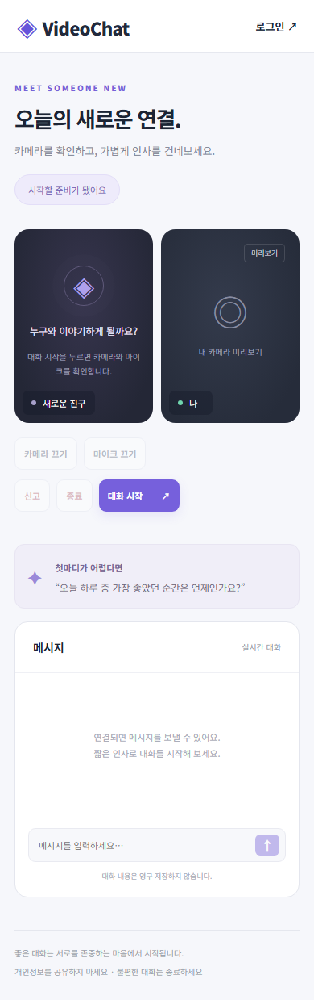
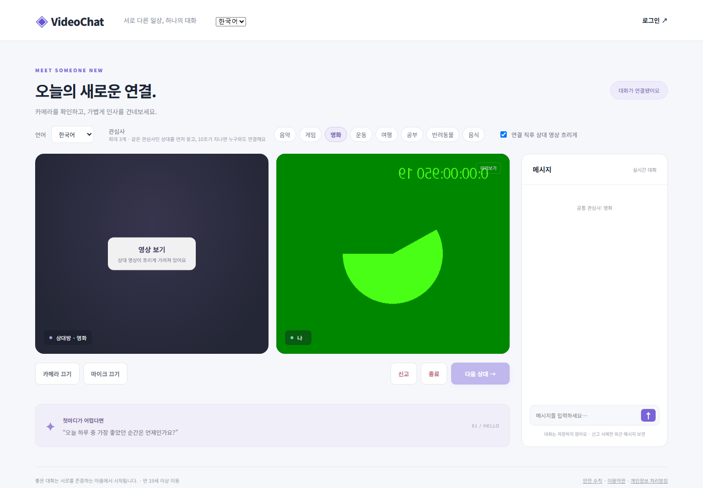
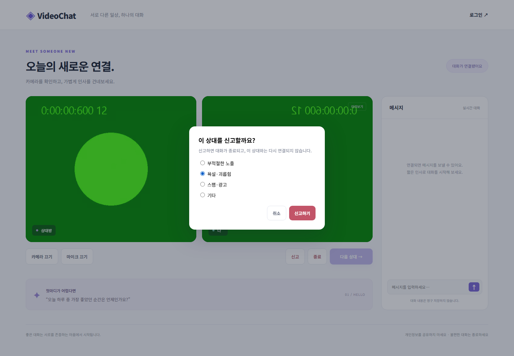

# VideoChat

Django Channels · Redis · WebRTC로 만든 랜덤 1:1 화상 대화 서비스입니다.
처음 만든 버전은 동시 접속에서 매칭이 깨졌습니다. 같은 부하 도구로 원인을 측정하고, 매칭 구조를 다시 설계한 뒤 결과를 수치로 검증했습니다.

| | 원본 (`c8d7002`) | 현재 |
| --- | --- | --- |
| 200명이 5초 안에 접속했을 때 정상 1:1 매칭 | **3 – 22%** (한 방 최대 15명, HTTP 500 발생) | **100%** (3회 반복) |
| 20명 대화 종료 후 다음 20명의 매칭 | 50 – 60% (유령 방에 혼자 대기) | 100% |
| 여러 서버 프로세스 | 지원 안 됨 | Linux 4개 프로세스 · 2,000명 동시 접속 100% (10초 분산 시 join→matched p95 4ms) |
| 한 프로세스에 1,000명 동시 접속 (Linux) | — | 4.6 – 43% → **100%** (channel layer backpressure, [T11](docs/troubleshooting.md#t11-한-프로세스에-1000명이-동시에-몰리면-매칭-알림이-유실됨)) |
| 접속 200명당 Redis 연결 | — | 212 → **17** (공유 풀) |
| 채팅 메시지 1개당 Redis 명령 | — | 26 → **10** (-62%) |
| 남용 대응 | 없음 | IP별 연결·로그인·가입 제한, 신고(대화 근거 포함)/차단/자동 제한, Prometheus 지표와 Grafana 대시보드 |

재구축 이후 추가한 기능은 이전 버전(`e0aaf87`)과 같은 테스트로 비교했습니다.

| | 이전 | 현재 |
| --- | --- | --- |
| 통화 중 신호 연결이 끊겼을 때 같은 상대와 대화 유지 | **0 / 20** | **20 / 20** (복구 중앙값 1.1초) |
| 통화 중 미디어 연결이 실패했을 때 복구 | **0 / 20** | **20 / 20** (ICE restart, 중앙값 0.6초) |
| 공통 관심사가 있는 상대와 매칭 (초당 10명 도착) | 40 – 46% | **99 – 100%** (대기 p95 +0.3초) |
| 통화가 실제로 연결됐는지, TURN을 거쳤는지 | 알 수 없음 | 매칭당 1회 집계(`calls_total`, `call_setup_seconds`, `calls_relayed_total`) |

측정 방법과 원자료: [docs/benchmarks](docs/benchmarks/README.md), [통화 품질](docs/call-quality.md), [선호 매칭](docs/matching-preferences.md) · 원인과 해결 과정: [트러블슈팅 T1–T16](docs/troubleshooting.md)

<p>
  
  
</p>

## 핵심 설계

- **원자적 매칭** — 서버가 Redis Lua 스크립트 하나로 "대기자 꺼내기 + 두 사람에게 같은 match_id 기록"을 처리합니다. 클라이언트는 방 번호를 고를 수 없습니다. 원본의 read-modify-write 카운터에서 생기던 정원 초과와 유령 방이 구조적으로 사라졌습니다([T1, T2](docs/troubleshooting.md)).
- **매칭 ID로 메시지 범위 제한** — SDP/ICE/채팅은 현재 match_id가 같을 때만 지정된 상대에게 전달됩니다. "다음 상대"로 넘어간 뒤 늦게 도착한 신호는 폐기됩니다.
- **장애에 스스로 회복** — 15초 heartbeat와 60초 presence TTL을 씁니다. 프로세스가 강제 종료돼도 수동으로 방을 초기화할 필요가 없습니다.
- **끊겨도 이어지는 대화** — 통화 중 신호 연결이 끊기면 서버가 매칭을 15초 보존하고, 브라우저는 영상을 유지한 채 새 소켓에서 1회용 토큰으로 같은 대화를 재개합니다. 미디어 경로가 끊기면 initiator가 ICE restart로 재협상합니다([통화 품질](docs/call-quality.md)).
- **언어·관심사 선호 매칭** — 공통 관심사가 많은 상대를 먼저 찾고, 10초가 지나면 조건을 풀어 누구와도 연결합니다. "기다리지 않고 가장 잘 맞는 사람" 방식은 측정해 보니 FIFO와 차이가 없어 채택하지 않았습니다([선호 매칭](docs/matching-preferences.md)).
- **수평 확장** — ASGI 프로세스가 여러 개여도 상태는 Redis 한 곳에만 있습니다. 부하 시험에서 클라이언트를 4개 프로세스에 나눠 붙여 프로세스 간 매칭을 검증했습니다.
- **남용 대응** — 게스트는 해시한 IP, 로그인 사용자는 계정 id로 식별합니다. IP별 동시 연결, 로그인 실패, 가입 횟수를 제한합니다. 신고하면 두 신원이 24시간 서로 매칭되지 않고, 서로 다른 3명이 신고하면 1시간 자동 제한됩니다([운영 기능](docs/operations.md)).
- **안전 장치** — 매칭 전에 만 19세 이상·이용수칙 동의를 받고, 서버가 매칭마다 다시 확인합니다. 본인인증 어댑터를 켜면 인증된 성인만 매칭하고, 제재를 IP가 아닌 인증된 사람에게 붙입니다. 상대 영상은 처음에 흐리게 보이고 사용자가 직접 걷어 냅니다([안전 장치](docs/trust-and-safety.md)).
- **신고 근거와 검토** — 신고하면 서버가 직접 중계한 최근 대화 20줄을 함께 저장합니다. 신고자가 내용을 꾸밀 수 없고, 신고하지 않으면 아무것도 저장하지 않습니다. 검토자가 신고를 인정하면 7일 제재, 기각하면 자동 제한을 해제하고, 제재받은 사람은 계정이 없어도 이의를 제기할 수 있습니다. 보관 기간이 지나면 자동으로 삭제합니다.
- **한국어 / English** — 헤더에서 화면 언어를 고릅니다. 번역 누락은 테스트가 막습니다([i18n](docs/i18n.md)).
- **관측 가능성** — `/metrics/`에서 매칭 대기시간, 통화 연결 성공률·소요 시간·TURN 경유, 끊김 복구, 거부·신고를 Prometheus 형식으로 제공합니다. `docker compose --profile monitoring up`으로 Grafana 대시보드와 경보 규칙 6개를 함께 띄웁니다.

<p>
  
  
</p>

구성요소별 책임과 상태 전이는 [설계 문서](docs/architecture.md)에 있습니다.

## 기술 스택

Python 3.12 · Django 5.2 · Channels 4 · Daphne · Redis(Lua, channel layer) · WebRTC · Vanilla JS · Playwright · GitHub Actions

## 로컬 실행

Python 3.12와 Redis가 필요합니다. Node.js 22 이상은 브라우저 테스트에만 필요합니다.

```powershell
python -m venv .venv
.venv\Scripts\python.exe -m pip install -r requirements.txt
$env:REDIS_URL = 'redis://127.0.0.1:6379/0'
$env:DJANGO_DEBUG = '1'   # 기본값은 꺼짐: 설정 없이 띄운 서버가 개발 모드로 돌지 않게
.venv\Scripts\python.exe backend/manage.py migrate
.venv\Scripts\python.exe backend/manage.py runserver 127.0.0.1:8000
```

Redis는 미리 실행해 두세요(`docker compose up redis -d`). 전체 개발 환경은 `docker compose up --build`로 실행할 수 있습니다.
접속 주소는 http://127.0.0.1:8000/chat/ 입니다. 환경변수 목록은 `.env.example`에 있습니다. Django는 이 파일을 자동으로 읽지 않으므로 셸이나 배포 환경에서 직접 지정하세요.

## 테스트

Redis를 실행한 상태에서 다음을 실행합니다.

```powershell
.venv\Scripts\python.exe backend/manage.py test chat main -v 2   # 64개: 매칭·선호·재개·시그널링·동의·본인인증·신고 검토·제재·이의·제한·지표·i18n·계정
npm install
npx playwright install chromium firefox
$env:BASE_URL = 'http://127.0.0.1:8000/chat/'
npm run test:e2e         # 실제 브라우저로 동의, WebRTC 연결, 채팅, 다음 상대, 재연결, 신고, 선호 매칭, 영상 흐림, 영어 화면
npm run test:interop     # Chromium ↔ Firefox 영상 협상과 채팅 (CI는 Linux에서 실행)
npm run test:resilience  # 통화 중 신호/미디어 끊김 후 같은 대화가 이어지는지 (시나리오별 5회)
```

브라우저 테스트는 가상 카메라와 마이크를 사용하므로 실제 영상을 촬영하지 않습니다. 개발 서버는 따로 실행해야 하며, 스크린샷은 `test-results/`에 저장됩니다.
부하 측정은 `requirements-dev.txt`를 설치한 뒤 `loadtest/bench.ps1`로 실행합니다([방법](docs/benchmarks/README.md#재현)).

## 운영 환경

- HTTPS와 WebSocket 업그레이드를 지원하는 리버스 프록시 뒤에서 Daphne를 실행합니다. 정적 파일(`collectstatic` 결과)은 프록시가 제공합니다.
- `DJANGO_DEBUG=0`, 충분히 긴 `DJANGO_SECRET_KEY`, 정확한 `DJANGO_ALLOWED_HOSTS`, `METRICS_TOKEN`을 설정합니다. `TRUST_PROXY=1`은 프록시가 전달 헤더를 덮어쓸 때만 사용합니다.
- Redis는 외부에 공개하지 않습니다. 매칭 상태는 임시 데이터라 복구할 필요가 없습니다.
- 서로 다른 네트워크 사이의 연결에는 TURN 서버가 필요합니다. `TURN_URLS`와 coturn 공유 비밀키 `TURN_SECRET`을 설정하면, 매칭할 때마다 1시간짜리 자격증명을 새로 발급합니다. 공유 비밀키는 브라우저로 보내지 않습니다.
- 서버는 채팅 내용을 저장하지 않습니다. 신고할 때만 최근 대화를 검토용으로 저장합니다. 영상과 음성은 서버를 거치지 않습니다(P2P 또는 TURN).

배포 절차와 점검 목록: [docs/deployment.md](docs/deployment.md)

## 문서

| 문서 | 내용 |
| --- | --- |
| [benchmarks](docs/benchmarks/README.md) | 부하 측정 방법, 원본 대비 결과, 원자료 |
| [troubleshooting](docs/troubleshooting.md) | 원본 결함과 재구축 중 발견한 문제 16건의 원인·해결·검증 |
| [call-quality](docs/call-quality.md) | 통화 품질 지표, 끊김 후 대화 재개와 ICE restart, 복구율 측정 |
| [matching-preferences](docs/matching-preferences.md) | 언어·관심사 매칭 규칙과 대기 시간 트레이드오프 측정 |
| [architecture](docs/architecture.md) | 책임 분리, 매칭 상태 전이, 장애 처리, 확장 제약 |
| [operations](docs/operations.md) | 요청 제한, 신고/차단 정책, 지표, Grafana·경보 |
| [competitive-analysis](docs/competitive-analysis.md) | Azar·OmeTV·Chatroulette 등 유사 서비스와 국내외 규제 비교, 보완점 |
| [trust-and-safety](docs/trust-and-safety.md) | 매칭 전 동의·본인인증 어댑터, 영상 흐림, 신고 검토·제재·이의 제기, 국내 고시 대응 |
| [i18n](docs/i18n.md) | 화면 언어 구조와 번역 추가 방법 |
| [code-review](docs/code-review.md) | 독립 코드 리뷰 15건과 수정·검증 내역 |
| [worklog](docs/worklog.md) | 날짜별 작업 기록: 무엇을, 왜, 어떤 결과로 |
| [verification](docs/verification.md) | 자동 검증 범위와 남은 검증 |
| [deployment](docs/deployment.md) | 운영 배포 구성과 점검 목록 |
| [repository-audit](docs/repository-audit.md) | 공개 이력에 남은 DB/개발 키, 라이선스 상태 |
| [history](docs/history/) | 원본 개발 당시의 트러블슈팅 메모와 WebRTC 학습 노트 |

CI(GitHub Actions)는 push마다 서버 테스트, Chromium e2e, Chromium↔Firefox 상호 운용, 끊김 복구 테스트를 돌립니다. 개발용 compose와 운영 Docker 이미지(Daphne, `DEBUG=0`)를 띄워 실제 WebSocket 매칭 200건을 확인하고, 모니터링 스택(Prometheus·Grafana)을 띄워 수집과 대시보드 등록도 확인하며, Linux 부하 측정을 실행합니다.
아직 하지 않은 것은 외부 서버 배포, TURN 서버 개설, 실제로 다른 네트워크 사이의 연결, Safari·모바일 실기기 검증입니다.
