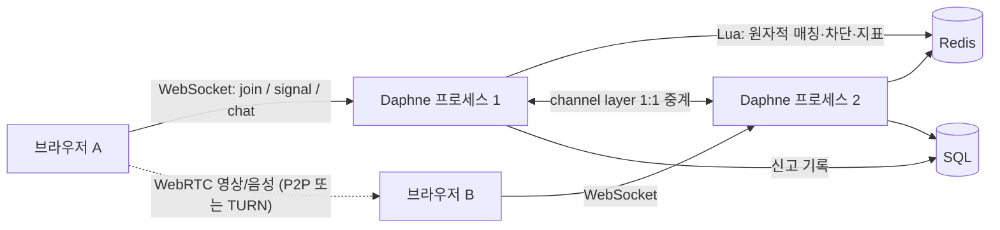

# 설계와 상태 전이

## 책임

| 구성요소 | 책임 |
| --- | --- |
| Django views/forms | 화면, 회원가입 검증, 인증, 단기 TURN 자격증명, 로그인/가입/RTC 요청 제한 |
| ChatConsumer | WebSocket 입력 검증, 속도 제한, IP별 연결 제한, 메시지 중계, 신고 접수(서버 중계 대화 근거 포함), 재개 토큰 발급, 끊긴 상대 유예 감시, 선호 재탐색, 통화 통계 수신, 연결 수명 |
| Matchmaker + Lua | 원자적 매칭, 언어·관심사 선호와 대기 완화, 매칭 ID, 상대 제외, 신고 차단/제한 확인, 통화 보존(suspend)·재개(resume), presence lease, 매칭 지표 |
| `chat/limits.py` | 신원(계정 id 또는 해시한 IP), 고정 윈도 제한, 동시 연결 집계, 카운터, 통화 품질 지표 집계 |
| 브라우저 controller | UI 상태, 로컬 장치, 선호 선택, WebRTC 협상, ICE restart, 끊김 시 통화 유지·재개, 통화 통계 보고, 재연결, 신고 다이얼로그 |
| Redis channel layer | 프로세스 간 신호 전달 |
| SQL | 회원/인증 데이터와 신고 기록(`chat.Report`). 매칭 경로에서는 사용하지 않음 |
| `/metrics/` | Redis에 모인 카운터와 현재 대기열/연결 수를 Prometheus 형식으로 노출 |

## 매칭

1. 사용자가 시작을 누르고 카메라·마이크를 허용합니다.
2. 미디어 준비 후 WebSocket을 열고 서버 ready에 join(선택한 언어·관심사 포함)으로 응답합니다.
3. Redis Lua가 대기열 앞쪽 후보 중 조건(언어·관심사, 또는 대기 완화)을 만족하고 관심사가 가장 많이 겹치는 한 명을 꺼내 양쪽에 동일한 UUID를 저장합니다. 적합한 상대가 없으면 대기열에 넣고, 선호가 있는 사용자는 완화 시간 뒤 스스로 다시 탐색합니다([선호 매칭](matching-preferences.md)).
4. 대기하던 쪽만 offer를 만듭니다. 상대는 answer를 만들고 양쪽은 ICE 후보를 교환합니다.
   각 참가자는 PeerConnection 생성 직전에 캐시하지 않는 RTC 설정 API를 호출합니다. TURN 인증정보는 매번 새로 발급하며, 종료/다음 상대 조작은 진행 중인 요청을 취소합니다. 이전 요청이 완료되어도 현재 매칭 ID와 다르면 연결을 생성하지 않습니다.
5. 모든 signal/chat/media는 현재 매칭 ID와 일치할 때만 지정된 상대에게 전달됩니다. 상대 채널과 매칭 ID는 매칭 확정 이벤트에서 Redis로 한 번 검증한 뒤 consumer가 보관하므로, 중계할 때는 Redis를 다시 조회하지 않습니다. 이미 다른 매칭으로 넘어간 쪽은 매칭 ID가 달라 메시지를 폐기합니다.
6. next는 기존 쌍을 해제한 후 새로 참가합니다. 떠난 상대는 자동 재매칭하지 않고 사용자가 다음 상대를 선택합니다.
7. leave(종료·다음 상대·신고)는 대기열과 연결 관계를 정리합니다. 이전 상대 제외 정보만 TTL 동안 남으며, 상대가 먼저 나간 뒤 다시 leave해도 유지됩니다.
   **통화 중 소켓만 끊긴 경우**는 leave하지 않고 매칭을 15초 보존(suspend)합니다. 새 소켓이 매칭 때 받은 1회용 토큰으로 resume하면 같은 대화를 이어 가고, 시간이 지나면 상대에게 종료를 알립니다([통화 품질과 끊김 복구](call-quality.md)).
8. 신고하면 신원 단위 상호 차단(24시간)이 추가되고 대화가 종료됩니다. 신고 누적으로 제한된 신원은 join 시 거부됩니다. 자세한 정책은 [운영 기능](operations.md)을 참고하세요.

매칭은 원자적이지만 사용자 알림은 비동기입니다. 알림을 보내기 직전에 Redis 상태를 다시 검사하여 이미 해제된 매칭을 시작하지 않습니다.
서로 동시에 나가거나 늦게 도착한 이벤트가 있어도 새 매칭에는 이전 신호가 전달되지 않습니다.

## 장애와 자원

- 15초마다 클라이언트 ping, 45초 이상 응답이 없으면 최대 다음 15초 검사 시점에 종료합니다.
- 프로세스 강제 종료 등으로 disconnect가 누락되면 60초 Redis TTL과 다음 접근 시 정리가 처리합니다.
- WebSocket 재연결은 최대 3번입니다. 통화 중이면 영상 연결을 유지한 채 0.5/1/1.5초 간격으로 재연결해 같은 대화를 재개하고, 대기 중이었으면 1/2/4초 간격으로 재연결해 새로 매칭합니다.
- 초기 WebRTC 연결 대기는 25초입니다. 실패 시 사용자에게 다음 상대 선택을 안내합니다. 연결된 뒤 `failed`가 되거나 `disconnected`가 3초 넘게 이어지면 initiator가 ICE restart를 수행합니다(최대 2회, 회당 12초).
- channels_redis는 프로세스의 모든 소켓이 수신함 하나를 공유합니다(용량 `CHANNEL_CAPACITY`, 기본 5,000). 가득 차면 최대 약 3초 재시도하고, 매칭 알림을 끝내 전하지 못하면 매칭을 되돌려 두 사람을 대기열로 돌려보냅니다([T11](troubleshooting.md#t11-한-프로세스에-1000명이-동시에-몰리면-매칭-알림이-유실됨)).
- 한 소켓당 순간 100개, 초당 30개 메시지; 최대 프레임 32 KiB, 채팅 2,000자, 화면 메시지 최대 200개입니다.
- 영상은 기본 640×480, 24fps(최대 30fps)를 요청합니다. 실제 인코딩과 대역폭은 브라우저가 협상합니다.
- 영상/음성은 WebRTC로 전송되며 Django를 경유하지 않습니다. 직접 연결이 어려우면 TURN을 경유합니다.
- 카메라 토글은 track.enabled를 변경합니다. 장치 트랙이 완전히 해제되는 시점은 종료/페이지 이탈입니다.

## 확장과 남은 제약

- ASGI 프로세스가 여러 개여도 하나의 Redis를 공유하면 매칭 상태가 일치합니다. 4개 프로세스에 나눠 붙인 800명 동시 접속에서 100% 정상 매칭을 확인했습니다([부하 측정](benchmarks/README.md)).
- 각 프로세스는 이벤트 루프당 상한 50의 Redis 연결 풀 하나를 공유합니다(`REDIS_POOL_SIZE`). 접속자 수와 Redis 연결 수가 비례하지 않습니다.
- Redis 단일 인스턴스 또는 Sentinel 형태를 전제로 합니다. 현재 Channels Redis 설정은 Redis Cluster 배포를 지원하도록 구성하지 않았습니다.
- 대기열 검색은 최대 100건이며, 대기 순서는 lease 갱신에 영향을 받습니다. 엄격한 FIFO는 아니고, 선호가 있으면 공통 관심사가 많은 후보를 우선합니다.
- 채널 메시지는 영구 이벤트 로그가 아닙니다. 소켓이 끊긴 15초 동안 상대가 보낸 채팅과 ICE 후보는 버려집니다(상대 화면의 입력은 잠김).
- 회원 데이터는 SQLite를 유지합니다. 여러 호스트 운영 전에 PostgreSQL 및 공유 세션 저장소로 전환해야 합니다.
- 원본의 Room 모델은 `main/0003_delete_room` 마이그레이션으로 제거했습니다(임시 매칭 데이터라 보존할 내용이 없음). 인증에 쓰이지 않던 CustomUser 테이블의 계정은 `main/0004`에서 auth.User로 옮긴 뒤 테이블을 삭제했습니다. 인증은 auth.User만 사용합니다.
- IP별 연결 제한, 로그인 시도 제한, 신고/차단, 모니터링 지표와 Grafana 대시보드·경보 규칙은 [운영 기능](operations.md)에 정리했습니다. 계정 복구와 경보 전달 채널(메일·메신저) 연결은 아직 없습니다.
- 실제 TURN 서버와 HTTPS 호스팅은 설정 가능한 상태이며 아직 외부 인프라에 배포하지 않았습니다.
