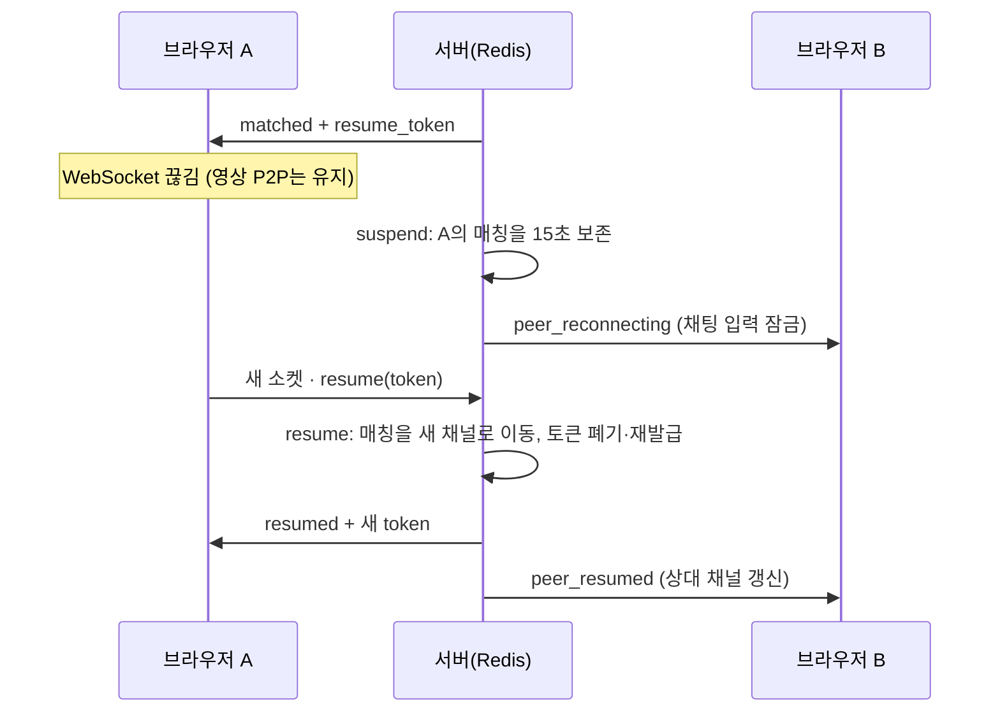

# 통화 품질 측정과 끊김 복구

작성일: 2026-10-25

## 왜 필요했나

서버는 "매칭 성공"까지만 알고 있었습니다. 영상과 음성은 브라우저끼리(P2P 또는 TURN) 주고받기 때문에, **매칭은 100%여도 방화벽 때문에 통화가 연결되지 않을 수 있고**, 그 비율을 셀 방법이 없었습니다.
또 통화 중 네트워크가 잠깐만 흔들려도 대화가 끝났습니다.

| 상황 | 이전 동작 |
| --- | --- |
| 신호 서버 연결(WebSocket)이 끊김 | 재연결은 됐지만 기존 대화는 버리고 새 상대를 찾음. 상대에게는 "상대방이 대화를 종료했어요" 표시 |
| 미디어 연결이 `failed` | 즉시 통화 종료, "다음 상대를 눌러 주세요" |
| 미디어 연결이 `disconnected` | "연결 복구 중"만 표시하고 기다림(아무 조치 없음) |

## 측정 방법 — `tests/resilience.cjs`

실제 브라우저 두 개를 연결한 뒤, 통화 중 장애를 일으키고 **같은 상대와 대화가 이어지는지** 반복해서 셉니다.

- **signaling**: 한쪽의 WebSocket을 실제로 닫습니다.
- **media**: 한쪽 `RTCPeerConnection`의 상태를 `failed`로 바꾸고 상태 변경 이벤트를 보냅니다. headless 브라우저에서는 같은 PC 안의 미디어 경로를 실제로 끊을 수 없어서 **상태 이벤트를 주입**했습니다. 이 방식은 실패를 감지한 뒤의 복구 로직(ICE restart 협상 전체)을 검증하지만, 실제 네트워크 단절에서의 ICE 동작까지 검증하지는 않습니다.
- **성공 판정**(모두 15초 안에):
  1. 같은 상대에게 채팅이 도착
  2. 상대가 "종료" 상태를 한 번도 보지 않음
  3. 양쪽 상태가 다시 "대화가 연결됐어요"이고 원격 영상이 재생 중

  채팅은 서버를 거치므로 1번만으로는 미디어 복구를 증명하지 못해서 3번 조건을 추가했습니다.

같은 테스트를 개선 전 커밋(`e0aaf87`, 별도 worktree)과 개선 후 코드에 각각 20회씩 실행했습니다. 원자료: [benchmarks/resilience.jsonl](benchmarks/resilience.jsonl)

| 시나리오 | 개선 전 | 개선 후 | 복구까지 걸린 시간 (중앙값 / 최대) |
| --- | --- | --- | --- |
| 신호 연결 끊김 | **0 / 20** | **20 / 20** | 1.13초 / 1.39초 |
| 미디어 연결 실패 | **0 / 20** | **20 / 20** | 0.62초 / 0.67초 |

신호 끊김 복구 시간의 대부분은 클라이언트의 첫 재연결 대기(0.5초)와 WebSocket 핸드셰이크입니다.
CI에서는 매 push마다 시나리오별 5회를 실행하고, 하나라도 실패하면 빌드를 실패시킵니다(`pnpm test:resilience`).

## 1. 대화 재개 (신호 연결 끊김)

- **서버**: 매칭이 확정되면 consumer가 추측 불가능한 토큰(`secrets.token_urlsafe`, 144비트)을 발급하고 `resume:<token> → 채널`로 저장합니다.
  - 소켓이 매칭 중에 끊기면 즉시 leave하지 않고 `suspend`합니다. 참가자 키는 `RESUME_GRACE_SECONDS`(기본 15초) 동안만 남고, 상대에게 `peer.suspended`를 보냅니다.
  - 새 소켓이 `resume`을 보내면 Lua가 원자적으로 처리합니다. 토큰 확인 → 상대가 아직 같은 매칭인지 확인 → 참가자 키를 새 채널로 이동 → 상대의 `peer` 필드 갱신 → 토큰 폐기. 그다음 상대 consumer에 `peer.moved`로 새 채널을 알립니다(중계에 쓰는 로컬 상대 채널 갱신).
- **상대 쪽**: `peer.suspended`를 받으면 유예 시간 + 1초 뒤 Redis 상태를 다시 확인하고, 재개되지 않았으면 `peer_left`를 보냅니다. ping 주기(15초)를 기다리지 않습니다.
- **클라이언트**: 매칭 중 소켓이 닫혀도 `RTCPeerConnection`과 원격 영상을 닫지 않습니다. 0.5초 뒤 재연결하고 `ready`를 받으면 `join` 대신 `resume`을 보냅니다. 실패하면(`resume_failed`) 그때 통화를 정리하고 새 상대를 찾습니다.
- **신원 유지**: Wi-Fi에서 LTE로 바뀌면 게스트의 IP 해시가 달라집니다. 그래서 재개된 연결은 원래 신원을 이어받습니다. 신고·차단이 네트워크 전환으로 풀리지 않게 하려는 것입니다.
- **경쟁 상황**: 이전 소켓의 종료가 서버에 늦게 도착해도(예: 단말이 네트워크를 잃어 TCP 종료가 없는 경우) 토큰은 매칭 시점에 등록돼 있으므로 재개됩니다. 뒤늦게 처리되는 이전 소켓의 종료는 키가 이미 옮겨져 아무 일도 하지 않습니다.

## 2. ICE restart (미디어 연결 끊김)

- `failed`이면 즉시, `disconnected`가 3초 넘게 이어지면 재협상을 시작합니다. `disconnected`는 저절로 회복되는 경우가 많아서 기다립니다.
- **offer는 항상 매칭 때 정해진 initiator만 만듭니다.** 반대쪽은 서버를 통해 `{restart: true}` 신호로 요청합니다. 양쪽이 동시에 offer를 만드는 glare를 피하려는 것입니다. 서버는 이 신호를 `is True`로 엄격하게 검증합니다(Python에서는 `1 == True`라서 `{"restart": 1}`도 통과하던 문제를 테스트로 발견했습니다).
- `createOffer({iceRestart: true})` 후 answer를 적용하면 연결 상태를 직접 확인합니다. 경로가 실제로 끊기지 않았던 경우에는 상태 변경 이벤트가 오지 않기 때문입니다.
- 한 번에 12초까지 기다리고, 두 번 연속 실패하면 통화를 종료합니다.

## 3. 통화 품질 지표

브라우저가 서버에 `stats` 메시지로 결과를 보내고, 서버가 Prometheus 지표로 집계합니다([operations.md](operations.md#지표-metrics)).

| 이벤트 | 보내는 쪽 | 서버 처리 |
| --- | --- | --- |
| `connected` (+ 매칭→연결 시간, TURN 경유 여부) | 양쪽 | 매칭당 1회만 집계(Redis `SET NX`) → `calls_total{outcome="connected"}`, `call_setup_seconds`, `calls_relayed_total` |
| `failed` (한 번도 연결되지 않음) | 양쪽 | 매칭당 1회 → `calls_total{outcome="failed"}` |
| `recovered` / `restart_failed` | offer를 만든 쪽만 | 매번 집계 → `ice_restarts_total{outcome}` |

- TURN 경유 여부는 `getStats()`에서 선택된 candidate pair의 후보 종류가 `relay`인지로 판단합니다. Chromium의 `transport.selectedCandidatePairId`와 Firefox의 `candidate-pair.selected`를 모두 처리합니다.
- 재개 결과는 서버가 직접 셉니다: `sessions_suspended_total`, `sessions_resumed_total{outcome="resumed|expired"}`.
- 로컬에서 20회씩 측정할 때 `/metrics/` 값이 실제 실행과 일치했습니다(통화 40건 연결, 재개 20건, ICE 복구 20건).

## 한계

- 미디어 단절은 상태 이벤트 주입으로 검증했습니다. 실제 Wi-Fi↔LTE 전환에서의 ICE 재수집과 TURN 전환은 실기기로 확인해야 합니다.
- 브라우저가 보내는 통계는 클라이언트가 조작할 수 있습니다. 운영 판단용 추세 지표로만 쓰고, 과금·제재 근거로 쓰지 않습니다. 매칭당 중복 집계와 값 범위는 서버에서 검증합니다.
- 유예 시간 동안 상대가 보낸 채팅과 ICE 후보는 버려집니다. 그래서 상대 화면의 채팅 입력은 잠깁니다.
- 프록시의 WebSocket idle timeout이 heartbeat(15초)보다 짧으면 끊김이 잦아집니다. nginx `proxy_read_timeout`은 75초를 권장합니다([deployment.md](deployment.md)).
