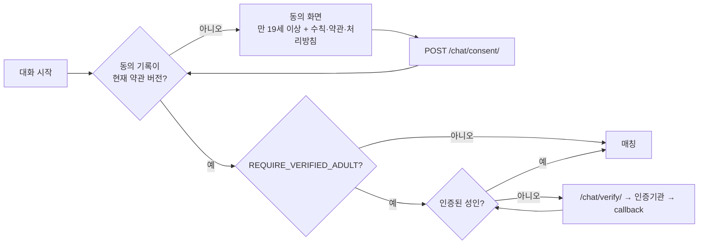
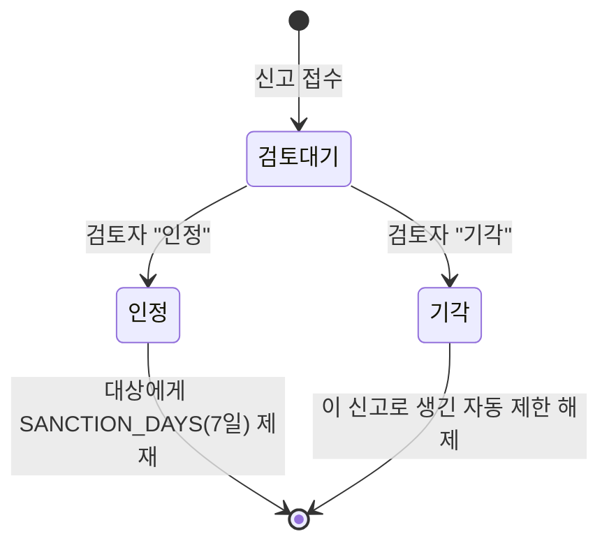

# 안전 장치: 동의, 본인인증, 영상 흐림, 신고 검토

작성일: 2026-10-25 · 배경: [유사 서비스 비교](competitive-analysis.md)

유사 서비스와 비교했을 때 가장 큰 차이가 안전 장치였습니다. 국내에는 랜덤채팅에 관한 2020년 여성가족부 고시도 있습니다. 이번에 추가한 기능과 그 이유를 정리합니다.

## 1. 매칭 전 확인 (동의 → 선택적으로 본인인증)

- **서버가 판단합니다.** 화면은 안내만 하고, 실제로 막는 곳은 WebSocket consumer입니다. consumer는 `join`/`next`마다 세션을 새로 읽어 확인하고, 조건이 빠져 있으면 `consent_required` 또는 `verification_required`를 보냅니다. 브라우저 코드를 고쳐도 건너뛸 수 없습니다.
- **약관 버전**(`CONSENT_VERSION`)을 올리면 모든 사용자가 다시 동의합니다.
- 동의는 본인이 직접 표시하는 방식이라 연령을 보증하지 못합니다. 규제 흐름(EU DSA 가이드라인, 영국 OSA)도 이 방식만으로는 부족하다고 봅니다. 그래서 본인인증을 붙일 자리를 함께 만들었습니다.

### 본인인증 어댑터 (`chat/verification.py`)

| 구성 | 역할 |
| --- | --- |
| `Verifier.begin(request)` | 인증 시작(실제 업체는 인증 화면으로 리다이렉트) |
| `Verifier.complete(request)` → `Verification(adult, subject)` | callback 결과 해석. `subject`는 인증기관이 사람마다 고정해서 주는 값(예: CI) |
| `DevVerifier` | 개발용. 입력을 그대로 믿습니다. **`DEBUG=0`에서 이 값으로 설정하면 서버가 시작을 거부합니다** |
| `IDENTITY_VERIFIER` | 사용할 어댑터의 경로. 실제 업체(PASS 등) 어댑터는 계약 후 이 인터페이스로 구현 |

- **저장하는 것**: 성인 여부와 `subject`의 HMAC 해시뿐입니다(세션). 이름·생년월일·전화번호는 받거나 저장하지 않습니다.
- **제재가 붙는 신원**의 우선순위는 **인증된 사람(`v…`) → 계정(`u…`) → IP 해시(`ip…`)**입니다. 인증을 켜면 IP를 바꾸거나 계정을 새로 만들어도 같은 사람에게 제재가 이어집니다. 유사 서비스 비교에서 4번째로 꼽은 보완점("IP보다 오래가는 제재 단위")입니다.
- 미성년자로 확인되면 이용 불가 안내와 청소년 상담(1388) 정보를 보여 줍니다. 결과를 세션에 남겨 대화 화면에서도 시작을 막습니다.
- 인증을 마친 뒤의 이동 주소(`next`)는 같은 사이트일 때만 따릅니다(외부로 보내는 오픈 리다이렉트 방지, 테스트 있음).

## 2. 연결 직후 상대 영상 흐림

- 매칭되면 상대 영상을 `blur(28px)`로 가리고 "영상 보기" 버튼을 띄웁니다. 사용자가 누를 때만 보입니다. 원치 않는 노출을 줄이려는 장치로, Azar의 Video Blur와 같은 목적입니다.
- 선호 영역의 "연결 직후 상대 영상 흐리게"로 끌 수 있고, 설정은 브라우저에 저장됩니다(기본은 켜짐).
- 영상을 서버가 보지 않으므로(P2P) 자동 판별은 아닙니다. 판별 없이 사용자 선택에 맡기는 방식입니다.

## 3. 신고 검토, 제재, 이의 제기

- **기록과 집행을 분리했습니다.** 제재는 SQL의 `Sanction`에 기록하고(누가, 언제부터 언제까지, 출처, 해제자), 매칭을 막는 일은 Redis의 `ban:<신원>`이 합니다. `sync_ban()`이 둘을 맞춥니다. 제재가 여러 건이면 **가장 긴 유효 제재**를 기준으로 하므로, 짧은 자동 제한을 해제해도 검토자의 7일 제재는 유지됩니다(테스트 있음).
- **자동 제한**: 서로 다른 3명이 신고하면 1시간 제한하고, `source=auto` 기록을 남깁니다. 검토자가 신고를 기각하면 해제됩니다.
- **이의 제기**: 제한된 사용자는 계정이 없어도 이의를 제기할 수 있습니다. 매칭이 거부될 때 1회용 코드(`/chat/appeal/<코드>/`, 제한 종료 후 하루까지 유효)를 받습니다. 제재 1건당 대기 중인 이의는 1건이고, IP당 시간당 5회로 제한합니다. 검토자가 수용하면 제재를 해제합니다.
- **admin**: 신고 목록은 상태·사유로 걸러 볼 수 있고, 처리 결과는 "인정 / 기각" 액션으로 남습니다. 검토자와 시각도 기록됩니다. 제재와 이의 목록도 따로 있습니다.

## 4. 정책 페이지와 데이터 보관

- `/terms/`, `/privacy/`, `/safety/`: 로비 하단과 동의 화면에서 연결됩니다. **포트폴리오 초안이라 운영 주체 정보와 법률 검토가 필요하다**고 페이지에 적었습니다.
- 개인정보 처리방침에는 **이 코드가 실제로 저장하는 것과 기간**만 적었습니다. 적힌 약속은 모두 코드로 지켜지는지 확인했습니다.
  - 계정 직접 삭제(비밀번호 확인)를 새로 만들었습니다.
  - 보관 기간이 지난 신고·제재·이의는 `purge_reports`가 삭제합니다(매일 실행).
  - IP 해시는 되돌릴 수 있는 가명 처리라고 밝혔습니다.
  - 상대에게 공인 IP가 보일 수 있다는 점을 고지했습니다.

## 국내 고시 요건과의 대응

2020년 여성가족부 고시는 랜덤채팅 서비스에 다음 세 가지 중 하나라도 없으면 청소년유해매체물로 봅니다([출처](competitive-analysis.md#규제--이-분야에서-운영자가-지는-의무)).

| 고시 항목 | 현재 |
| --- | --- |
| 실명·휴대폰 본인인증 | 어댑터와 강제 옵션(`REQUIRE_VERIFIED_ADULT`)은 구현했지만, 실제 인증기관 연동은 계약이 필요해 아직 없음 |
| 대화 내용 저장 | 신고할 때만 서버가 중계한 대화를 저장(90일). 모든 대화를 상시 저장하지는 않음 |
| 신고 기능 | 있음(검토·제재·이의 절차 포함) |

그래서 지금 상태로 공개 운영한다면 청소년유해매체물로 보고, **19세 이용 표시와 성인 확인**을 해야 한다고 판단했습니다. 성인 확인은 동의 화면과 본인인증 강제 옵션이 담당합니다. 이 판단은 공개 자료를 읽고 내린 것이며 법률 자문이 아닙니다. 실제로 운영하기 전에는 전문가 검토가 필요합니다.
